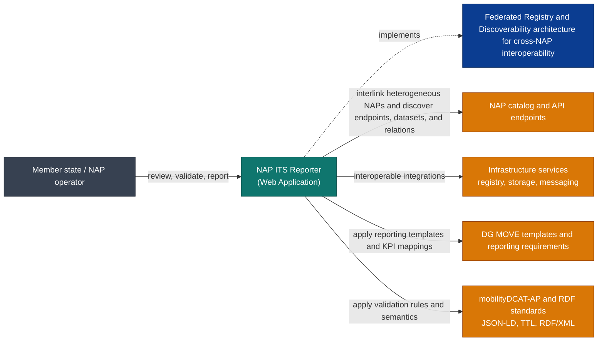

# NAP ITS Reporter

NAP ITS Reporter is a pilot web application for mobilityDCAT-AP metadata processing across National Access Points (NAPs).

The architecture follows a Federated Registry and Discoverability approach for cross-NAP interoperability. It supports:

- metadata discovery and ingestion,
- compliance validation against mobilityDCAT-AP and DG MOVE requirements,
- KPI mapping and reporting workflows,
- dataset health readiness evaluation based on dataset ID resolution and endpoint availability checks.

## Architecture Overview (C4)

The system is modeled with C4 diagrams from context down to component level:

- Level 1 (System Context): main actors, external systems, and integration boundaries.
- Level 2 (Container): presentation, service, and data layers.
- Level 3 (Components): internal components for validation, reporting, and registry/discoverability.
- Level 4 (Code-oriented docs): service-level internals and runtime flows.

### C4 - System Context (Level 1)

## Main Building Blocks

- Web UI and API documentation portal
- API Gateway / BFF
- Metadata Ingestion Service
- Federated Registry and Discoverability Service
- Compliance Validation Service
- KPI Mapping and Analytics Service
- Reporting Service
- Recommendation Service
- Workflow Orchestrator
- AuthN/AuthZ Service
- Metadata Store, Application DB, Document Store, Event Bus

## Dataset Health Readiness

The Registry and Discoverability service evaluates dataset health per dataset ID found in mobilityDCAT-AP metadata.

Primary readiness states:

- ready
- degraded
- unavailable
- unknown

A dataset is considered ready when metadata resolution succeeds, a usable access endpoint is present, service probing succeeds, and freshness policy is satisfied.

## Key Documentation

- Architecture index: [docs/architecture/c4-design.md](docs/architecture/c4-design.md)
- Strict C4 model: [docs/architecture/c4-structurizr.dsl](docs/architecture/c4-structurizr.dsl)
- Level 4 Validation service: [docs/architecture/c4-level4-validation.md](docs/architecture/c4-level4-validation.md)
- Level 4 Reporting service: [docs/architecture/c4-level4-reporting.md](docs/architecture/c4-level4-reporting.md)
- Level 4 Registry and Discoverability service: [docs/architecture/c4-level4-registry-discoverability.md](docs/architecture/c4-level4-registry-discoverability.md)

## Diagram Exports (SVG)

- System context: [docs/architecture/svg/system-context.svg](docs/architecture/svg/system-context.svg)
- Container view: [docs/architecture/svg/container.svg](docs/architecture/svg/container.svg)
- Validation components: [docs/architecture/svg/validation-components.svg](docs/architecture/svg/validation-components.svg)
- Reporting components: [docs/architecture/svg/reporting-components.svg](docs/architecture/svg/reporting-components.svg)
- Registry module view: [docs/architecture/svg/registry-discoverability-module-view.svg](docs/architecture/svg/registry-discoverability-module-view.svg)
- Registry runtime flow: [docs/architecture/svg/registry-discoverability-primary-runtime-flow.svg](docs/architecture/svg/registry-discoverability-primary-runtime-flow.svg)

## API Contracts

- BFF API: [docs/api/openapi-bff.yaml](docs/api/openapi-bff.yaml)
- Validation API: [docs/api/openapi-validation.yaml](docs/api/openapi-validation.yaml)
- Reporting API: [docs/api/openapi-reporting.yaml](docs/api/openapi-reporting.yaml)

## How to Contribute

- Read the contribution guide: [CONTRIBUTING.md](CONTRIBUTING.md)
- Use feature branches for changes and open a pull request.
- Follow commit, push, PR, and merge rules defined in the contribution guide.

## Repository Structure

- [docs](docs): architecture, API contracts, and exported diagrams
- [scaffold](scaffold): implementation scaffold and service skeletons
