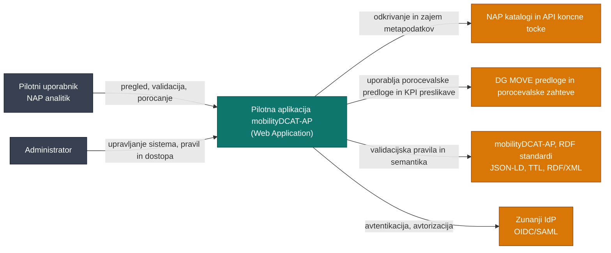
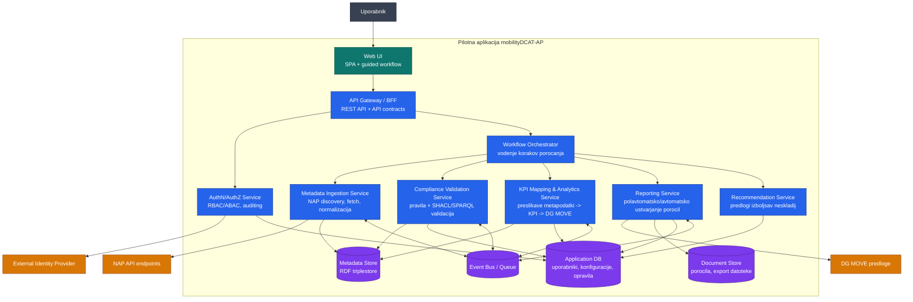

# Razvoj pilotne aplikacije za avtomatizirano zbiranje in obdelavo metapodatkov mobilityDCAT-AP

Ta dokument predstavlja zacetni C4 nacrt za spletno aplikacijo na podlagi pogodbenih zahtev.

## 1) C4 - System Context (Level 1)

Za strogo C4 notacijo (Structurizr DSL) glej: `docs/architecture/c4-structurizr.dsl`.



## 2) C4 - Container Diagram (Level 2)



## 3) C4 - Component Diagram (Level 3)

### 3.1 Compliance Validation Service

```mermaid
flowchart LR
    classDef svc fill:#2563eb,stroke:#1e3a8a,color:#fff
    classDef data fill:#7c3aed,stroke:#4c1d95,color:#fff
    classDef ext fill:#d97706,stroke:#92400e,color:#fff

    API[Validation API\n(start/check/status)]:::svc
    RuleRepo[Rule Repository\nmobilityDCAT-AP + DG MOVE rules]:::svc
    ShapeEngine[SHACL Engine]:::svc
    SemanticChecks[SPARQL Semantic Checks]:::svc
    Completeness[Completeness & Consistency Checker]:::svc
    ReportBuilder[Neskladja + priporocila\nReport Builder]:::svc

    META[(RDF Metadata Store)]:::data
    APPDB[(Application DB)]:::data
    STD[Standard packs\nversioned rules]:::ext

    API --> RuleRepo
    API --> ShapeEngine
    API --> SemanticChecks
    API --> Completeness
    ShapeEngine --> META
    SemanticChecks --> META
    Completeness --> META
    RuleRepo --> STD
    ShapeEngine --> ReportBuilder
    SemanticChecks --> ReportBuilder
    Completeness --> ReportBuilder
    ReportBuilder --> APPDB
```

### 3.2 Reporting Service

```mermaid
flowchart LR
    classDef svc fill:#2563eb,stroke:#1e3a8a,color:#fff
    classDef data fill:#7c3aed,stroke:#4c1d95,color:#fff
    classDef ext fill:#d97706,stroke:#92400e,color:#fff

    RAPI[Reporting API]:::svc
    Mapper[KPI/Template Mapper]:::svc
    Guide[Guided Report Assistant]:::svc
    Generator[Report Generator\n(partial/full auto)]:::svc
    Exporter[Exporter\nPDF/HTML/JSON]:::svc

    APPDB[(Application DB)]:::data
    DOCS[(Document Store)]:::data
    DGT[DG MOVE templates]:::ext

    RAPI --> Mapper
    RAPI --> Guide
    RAPI --> Generator
    Mapper --> DGT
    Guide --> APPDB
    Generator --> APPDB
    Generator --> DOCS
    Generator --> Exporter
```

## 4) Zahteve -> C4 pokritost (povzetek)

- Zbiranje metapodatkov: `Metadata Ingestion Service`, `NAP adapters`, podpora RDF formatom v API pogodbah.
- Preverjanje skladnosti: `Compliance Validation Service`, `Rule Repository`, `SHACL/SPARQL`.
- Delovni tok porocanja: `Workflow Orchestrator`, `Reporting Service`, `Guided Report Assistant`, `KPI Mapping`.
- Modularna arhitektura: mikroservisi + loceni podatkovni, logcni in predstavitveni sloj.
- Sistemska arhitektura: `API Gateway/BFF`, standardizirani API contracts, `AuthN/AuthZ`, event-driven integracije.
- UI zahteve: `Web UI` z nadzorno plosco za validacijo, neskladja, priporocila in porocevalske tokove.

## 5) Izdelani nadaljnji koraki

- C4 Level 4 (Code) za Validation Service: `docs/architecture/c4-level4-validation.md`
- C4 Level 4 (Code) za Reporting Service: `docs/architecture/c4-level4-reporting.md`
- OpenAPI osnutek za BFF: `docs/api/openapi-bff.yaml`
- OpenAPI osnutek za Validation Service: `docs/api/openapi-validation.yaml`
- OpenAPI osnutek za Reporting Service: `docs/api/openapi-reporting.yaml`
- One-page architecture brief: `docs/brief/architecture-one-pager.md`
- Stroga C4 notacija (Structurizr DSL): `docs/architecture/c4-structurizr.dsl`
- Implementacijski API-first scaffold: `scaffold/README.md`

## 6) Predlagan naslednji korak

- Definicija C4 Level 4 za preostale storitve (Ingestion, Workflow, IAM).
- Definicija podatkovnega modela (RDF named graphs + relacijski model za workflow stanje).
- Priprava testne strategije (unit/integration/system/performance) po modulu.
