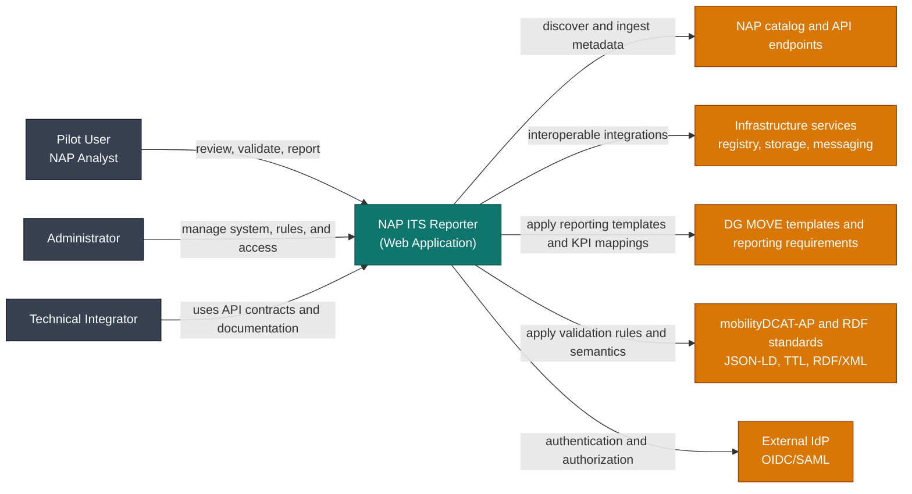
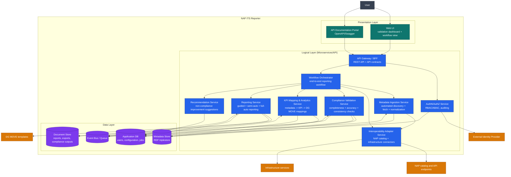

# NAP ITS Reporter - C4 Architecture Design

This document provides the initial C4 architecture design for the web application based on the contract requirements.

## 1) C4 - System Context (Level 1)

For strict C4 notation (Structurizr DSL), see: `docs/architecture/c4-structurizr.dsl`.



## 2) C4 - Container Diagram (Level 2)



## 3) C4 - Component Diagram (Level 3)

### 3.1 Compliance Validation Service

```mermaid
flowchart LR
    classDef svc fill:#2563eb,stroke:#1e3a8a,color:#fff
    classDef data fill:#7c3aed,stroke:#4c1d95,color:#fff
    classDef ext fill:#d97706,stroke:#92400e,color:#fff

    API[Validation API\n(start/check/status)]:::svc
    RuleRepo[Rule Repository\nmobilityDCAT-AP + DG MOVE rules]:::svc
    ShapeEngine[SHACL Engine]:::svc
    SemanticChecks[SPARQL Semantic Checks]:::svc
    DataQuality[Completeness + Accuracy + Consistency\nChecks]:::svc
    NonComplianceReport[Non-compliance Report Generator]:::svc
    ReportBuilder[Recommendation Report Builder]:::svc

    META[(RDF Metadata Store)]:::data
    APPDB[(Application DB)]:::data
    STD[Standard packs\nversioned rules]:::ext

    API --> RuleRepo
    API --> ShapeEngine
    API --> SemanticChecks
    API --> DataQuality
    ShapeEngine --> META
    SemanticChecks --> META
    DataQuality --> META
    RuleRepo --> STD
    ShapeEngine --> NonComplianceReport
    SemanticChecks --> NonComplianceReport
    DataQuality --> NonComplianceReport
    NonComplianceReport --> ReportBuilder
    ReportBuilder --> APPDB
```

### 3.2 Reporting Service

```mermaid
flowchart LR
    classDef svc fill:#2563eb,stroke:#1e3a8a,color:#fff
    classDef data fill:#7c3aed,stroke:#4c1d95,color:#fff
    classDef ext fill:#d97706,stroke:#92400e,color:#fff

    RAPI[Reporting API]:::svc
    Mapper[KPI/Template Mapper]:::svc
    DgMoveMapper[DG MOVE Template Mapper]:::svc
    Guide[Guided Report Assistant]:::svc
    AutomationPlanner[Automation Planner\n(manual assist / semi / full)]:::svc
    Generator[Report Generator\n(partial/full auto)]:::svc
    Exporter[Exporter\nPDF/HTML/JSON]:::svc

    APPDB[(Application DB)]:::data
    DOCS[(Document Store)]:::data
    DGT[DG MOVE templates]:::ext

    RAPI --> Mapper
    RAPI --> DgMoveMapper
    RAPI --> Guide
    RAPI --> AutomationPlanner
    RAPI --> Generator
    Mapper --> DGT
    DgMoveMapper --> DGT
    Guide --> APPDB
    AutomationPlanner --> APPDB
    Generator --> APPDB
    Generator --> DOCS
    Generator --> Exporter
```

## 4) Requirement-to-C4 Coverage (Summary)

- Metadata collection: `Metadata Ingestion Service` and `Interoperability Adapter Service` with automated discovery/fetch from NAP and support for JSON-LD, Turtle (.ttl), and RDF/XML (.rdf).
- Compliance verification: `Compliance Validation Service` with completeness, accuracy, and consistency checks, plus non-compliance report and recommendation generation.
- Reporting workflow: `Workflow Orchestrator`, `Guided Report Assistant`, KPI mappings, DG MOVE template mappings, and semi/full automation modes.
- Modular architecture and interoperability: microservices with explicit presentation, logical, and data layers; clear service-to-service data flows; integration modules for NAP catalog and infrastructure services.
- System architecture and security: `API Gateway/BFF`, standardized data models and API contracts, `AuthN/AuthZ`, access control, and event-driven integration.
- UI requirements: `Web UI` with intuitive workflow control, compliance visualization, recommendation access, and transparent reporting workflow progress.

## 5) Completed Next-Step Artifacts

- C4 Level 4 (Code) for Validation Service: `docs/architecture/c4-level4-validation.md`
- C4 Level 4 (Code) for Reporting Service: `docs/architecture/c4-level4-reporting.md`
- OpenAPI draft for BFF: `docs/api/openapi-bff.yaml`
- OpenAPI draft for Validation Service: `docs/api/openapi-validation.yaml`
- OpenAPI draft for Reporting Service: `docs/api/openapi-reporting.yaml`
- One-page architecture brief: `docs/brief/architecture-one-pager.md`
- Strict C4 notation (Structurizr DSL): `docs/architecture/c4-structurizr.dsl`
- Implementation API-first scaffold: `scaffold/README.md`

## 6) Proposed Next Step

- Define C4 Level 4 for remaining services (Ingestion, Workflow, IAM).
- Define the data model (RDF named graphs plus relational workflow state model).
- Prepare a testing strategy (unit/integration/system/performance) per module.

## 7) PUML and SVG Diagrams

- PUML System Context: `docs/architecture/puml/system-context.puml`
- SVG System Context: `docs/architecture/svg/system-context.svg`
- PUML Container: `docs/architecture/puml/container.puml`
- SVG Container: `docs/architecture/svg/container.svg`
- PUML Validation Components: `docs/architecture/puml/validation-components.puml`
- SVG Validation Components: `docs/architecture/svg/validation-components.svg`
- PUML Reporting Components: `docs/architecture/puml/reporting-components.puml`
- SVG Reporting Components: `docs/architecture/svg/reporting-components.svg`
