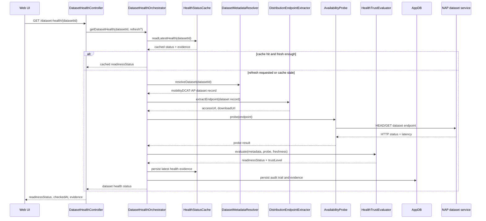
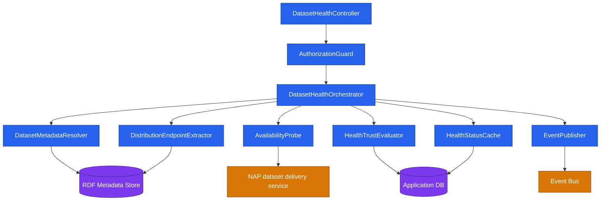
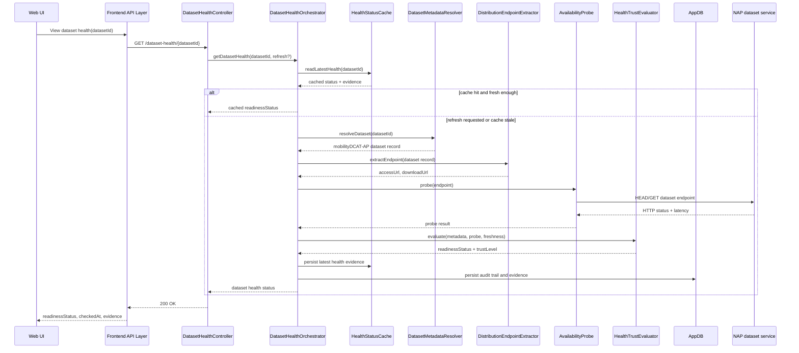

# C4 Level 4 - NAP Dataset Health Status Service

This document describes the internal (code-level) design of the microservice responsible for trusted dataset readiness evaluation.

## Purpose

- Accepts a dataset health query for a specific `datasetId`.
- Resolves the dataset record from mobilityDCAT-AP metadata.
- Extracts the distribution or service endpoint for the dataset.
- Probes the target dataset service for availability and freshness.
- Persists a trustable dataset health status with supporting evidence.

## Dataset Health Semantics

The service evaluates health per `datasetId`.

- `ready`: dataset metadata resolves successfully, a usable access or distribution URL exists, the target service probe succeeds, and the result is still fresh enough to trust.
- `degraded`: dataset resolves, but probe quality is below policy threshold, for example intermittent failures or slow responses.
- `unavailable`: dataset resolves, but the referenced service is currently unreachable or returning failing status codes.
- `unknown`: metadata is missing, incomplete, or no trusted probe result is available yet.

## Why the Trust Evaluator and Cache Exist

The service does not treat probe results as the final answer. A raw endpoint check can succeed or fail for reasons that are too noisy to expose directly to API consumers, so `HealthTrustEvaluator` turns metadata, probe evidence, and freshness rules into a stable public status.

- `HealthTrustEvaluator` decides whether the current evidence is strong enough to publish as `ready`, `degraded`, `unavailable`, or `unknown`.
- `HealthStatusCache` stores the last trusted decision plus evidence so repeated reads can return quickly without probing every time.
- Together, they separate the expensive operation of checking a live dataset endpoint from the cheap operation of serving the latest trusted answer.
- This keeps the service fast, reduces load on NAP endpoints, and preserves the evidence needed to explain the published status.

## At a Glance

- `AvailabilityProbe` answers: “can I reach the dataset service right now?”
- `HealthTrustEvaluator` answers: “is this result trustworthy enough to publish as the current health status?”
- `HealthStatusCache` stores the evaluator’s last trusted decision so reads stay fast

## Trust and Cache Sketch

## Module View

- Mermaid source: `docs/architecture/mermaid/dataset-health-module-view.mmd`
- SVG export: `docs/architecture/svg/dataset-health-module-view.svg`

## Primary Runtime Flow (Sequence)

- Mermaid source: `docs/architecture/mermaid/dataset-health-primary-runtime-flow.mmd`
- SVG export: `docs/architecture/svg/dataset-health-primary-runtime-flow.svg`

## Key Internal Components

- DatasetHealthController: REST entry point for dataset health lookup and refresh.
- DatasetHealthOrchestrator: coordinates metadata resolution, probing, trust evaluation, and response composition.
- DatasetMetadataResolver: resolves `datasetId` to the authoritative mobilityDCAT-AP dataset graph.
- DistributionEndpointExtractor: extracts probeable URLs from distributions and data services.
- AvailabilityProbe: performs HTTP or service-level checks and records latency and status.
- HealthTrustEvaluator: applies readiness and freshness policy to determine whether the result is trusted and publishable.
- HealthStatusCache: stores the latest trusted health snapshot, its evidence, and the timestamp used to decide whether a refresh is needed.

## Proposed Internal Code Contracts

- Query: GetDatasetHealthQuery
- Command: RefreshDatasetHealthCommand
- Event: DatasetHealthEvaluated, DatasetHealthChanged
- DTO: DatasetHealthStatusDto, HealthEvidenceDto

## Non-Functional Requirements

- Dataset health lookup should return cached status in < 300 ms (p95) when no refresh is requested.
- Fresh probes should be policy-driven and bounded by configurable timeout budgets.
- Health evaluation must be deterministic for the same metadata snapshot and probe evidence.
- All health decisions must keep audit evidence for traceability and trust review.
