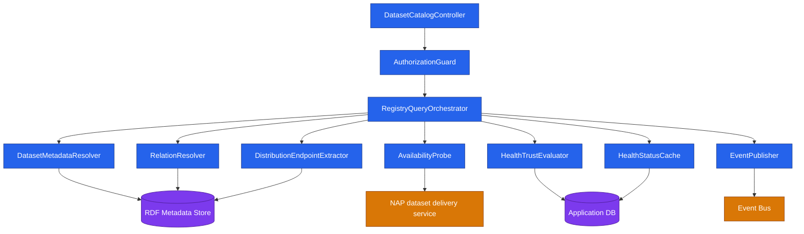
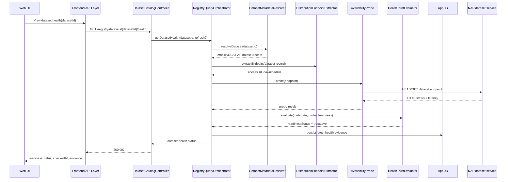

# C4 Level 4 - Federated Registry and Discoverability Service

This document describes the internal (code-level) design of the microservice responsible for NAP registry discovery, dataset lookup, and trusted dataset health readiness evaluation.

## Purpose

- Maintains the federated catalog of NAP endpoints, datasets, and cross-NAP relations.
- Resolves dataset identifiers from mobilityDCAT-AP metadata records.
- Verifies availability of the dataset service referenced by metadata distributions.
- Publishes a trusted dataset health status with `ready` as the primary healthy state.

## Dataset Health Semantics

The service evaluates health per `datasetId`.

- `ready`: dataset metadata resolves successfully, a usable access or distribution URL exists, the target service probe succeeds, and the result is still fresh enough to trust.
- `degraded`: dataset resolves, but probe quality is below policy threshold, for example intermittent failures or slow responses.
- `unavailable`: dataset resolves, but the referenced service is currently unreachable or returning failing status codes.
- `unknown`: metadata is missing, incomplete, or no trusted probe result is available yet.

## Module View

## Primary Runtime Flow (Sequence)

## Key Internal Components

- DatasetCatalogController: REST entry point for registry dataset lookup and health queries.
- RegistryQueryOrchestrator: coordinates metadata resolution, probing, trust evaluation, and response composition.
- DatasetMetadataResolver: resolves `datasetId` to the authoritative mobilityDCAT-AP dataset graph.
- RelationResolver: loads registry relations and related datasets for explainability.
- DistributionEndpointExtractor: extracts probeable URLs from distributions and data services.
- AvailabilityProbe: performs HTTP or service-level checks and records latency and status.
- HealthTrustEvaluator: applies readiness and freshness policy to determine whether the result is trusted.
- HealthStatusCache: stores the latest computed health snapshot and avoids unnecessary repeated probes.

## Proposed Internal Code Contracts

- Query: GetRegistryDatasetQuery
- Query: GetDatasetHealthQuery
- Command: RefreshDatasetHealthCommand
- Event: DatasetHealthEvaluated, DatasetHealthChanged
- DTO: RegistryDatasetDto, DatasetHealthStatusDto, HealthEvidenceDto

## Non-Functional Requirements

- Dataset health lookup should return cached status in < 300 ms (p95) when no refresh is requested.
- Fresh probes should be policy-driven and bounded by configurable timeout budgets.
- Health evaluation must be deterministic for the same metadata snapshot and probe evidence.
- All health decisions must keep audit evidence for traceability and trust review.