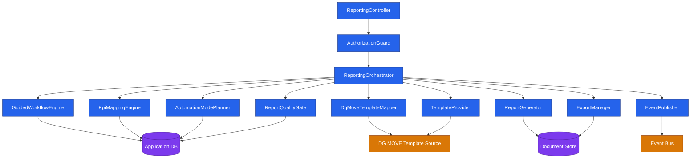
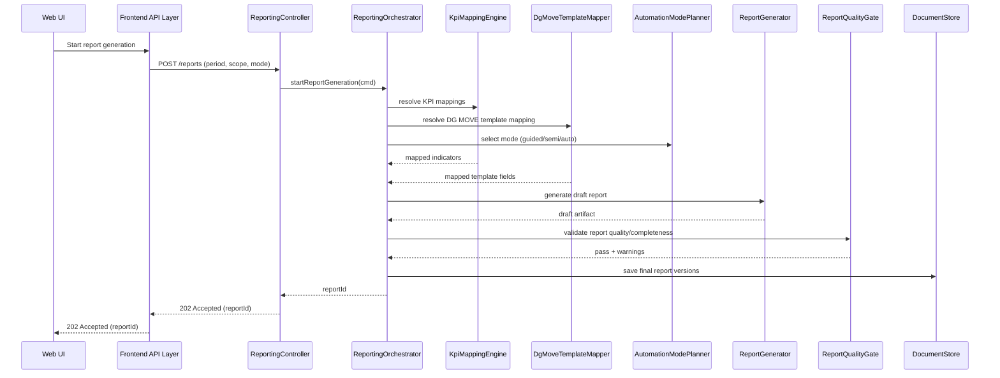

# C4 Level 4 - Reporting Service

This document describes the internal (code-level) design of the microservice for DG MOVE report preparation based on collected and validated metadata.

## Purpose

- Manages a guided reporting workflow.
- Maps metadata (mobilityDCAT-AP) elements to KPI and DG MOVE templates.
- Supports partially or fully automated report generation.
- Provides documentation-ready report outputs and exports.

## Module View

## Primary Runtime Flow (Sequence)

- Mermaid source: `docs/architecture/mermaid/reporting-primary-runtime-flow.mmd`
- SVG export: `docs/architecture/svg/reporting-primary-runtime-flow-mermaid.svg`

## Key Internal Components

- ReportingController: API for starting report generation, checking status, and downloading exports.
- GuidedWorkflowEngine: guides users through steps and validates required inputs.
- KpiMappingEngine: maps mobilityDCAT-AP elements to KPI and templates.
- DgMoveTemplateMapper: maps KPI outputs into DG MOVE template fields.
- TemplateProvider: manages DG MOVE template versions.
- AutomationModePlanner: applies guided, semi-automatic, or full-automatic generation mode.
- ReportGenerator: composes report outputs (narrative + tables + indicators).
- ReportQualityGate: validates completeness, compliance, and output consistency.
- ExportManager: exports outputs to PDF/HTML/JSON.

## Proposed Internal Code Contracts

- Command: StartReportGenerationCommand
- Query: GetReportStatusQuery
- Event: ReportGenerated, ReportPublished
- DTO: ReportSummaryDto, KpiSnapshotDto

## Non-Functional Requirements

- Support for partial and full automatic modes (manual assist / auto).
- Report versioning and reproducible generation.
- Audit trail of changes per workflow step.
- API response target for report submission: < 300 ms (p95).
