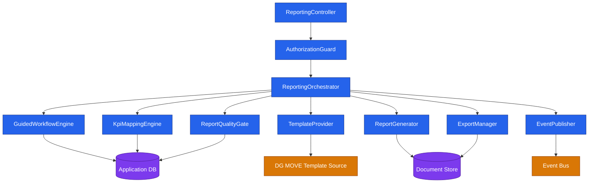
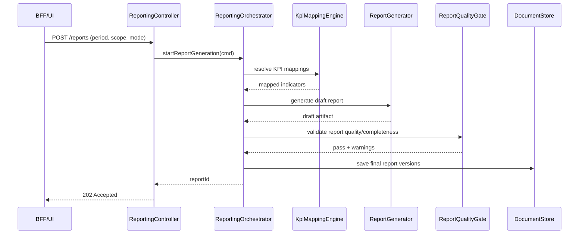

# C4 Level 4 - Reporting Service

Ta dokument opisuje notranjo (code-level) zasnovo mikroservisa za pripravo porocil DG MOVE na podlagi zbranih in validiranih metapodatkov.

## Namen

- Upravljanje vodnega (guided) porocevalskega toka.
- Preslikava metapodatkovnih elementov v KPI in DG MOVE predloge.
- Delno ali v celoti avtomatizirana izdelava porocil.

## Modulni pogled

## Primarni runtime tok (sekvenca)

## Kljucne notranje komponente

- ReportingController: API za zagon porocila, pregled statusa, prevzem exportov.
- GuidedWorkflowEngine: vodi uporabnika po korakih in preverja obvezna polja.
- KpiMappingEngine: mapira mobilityDCAT-AP elemente v KPI in predloge.
- TemplateProvider: upravlja verzije predlog DG MOVE.
- ReportGenerator: sestavi porocilo (narrative + tabele + kazalniki).
- ReportQualityGate: kontrola popolnosti, skladnosti in konsistentnosti outputa.
- ExportManager: izvoz v PDF/HTML/JSON.

## Predlagane kode pogodbe (notranje)

- Command: StartReportGenerationCommand
- Query: GetReportStatusQuery
- Event: ReportGenerated, ReportPublished
- DTO: ReportSummaryDto, KpiSnapshotDto

## Nefunkcionalne zahteve

- Podpora za delni in polni avtomatski nacin (manual assist / auto).
- Verzije porocil in ponovljivost generiranja.
- Audit trail sprememb po korakih workflow.
- Cilj odziva API za oddajo porocila: < 300 ms (p95).
