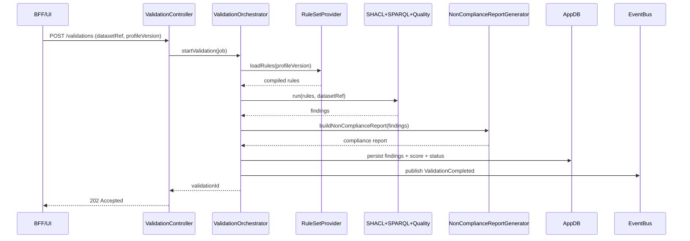

# C4 Level 4 - Compliance Validation Service

This document describes the internal (code-level) design of the microservice for automated mobilityDCAT-AP metadata compliance validation.

## Purpose

- Accepts a validation job for one or more metadata records.
- Executes syntactic, semantic, and business validation checks.
- Validates completeness, accuracy, and consistency.
- Persists validation results and generates non-compliance reports and improvement recommendations.

## Module View

```mermaid
flowchart TB
    classDef mod fill:#2563eb,stroke:#1e3a8a,color:#fff
    classDef data fill:#7c3aed,stroke:#4c1d95,color:#fff
    classDef ext fill:#d97706,stroke:#92400e,color:#fff

    API[ValidationController]:::mod
    AUTH[AuthorizationGuard]:::mod
    ORCH[ValidationOrchestrator]:::mod
    RULES[RuleSetProvider]:::mod
    PARSER[RDFParserAdapter]:::mod
    SHACL[ShaclValidationEngine]:::mod
    SPARQL[SparqlRuleEngine]:::mod
    QCHECK[QualityChecksEngine\n(completeness, accuracy, consistency)]:::mod
    NCREP[NonComplianceReportGenerator]:::mod
    AGG[ResultAggregator]:::mod
    RECO[RecommendationBuilder]:::mod
    PUB[EventPublisher]:::mod

    META[(RDF Store)]:::data
    APPDB[(Application DB)]:::data
    PACKS[Versioned Rule Packs]:::ext
    BUS[Event Bus]:::ext

    API --> AUTH
    AUTH --> ORCH
    ORCH --> RULES
    ORCH --> PARSER
    ORCH --> SHACL
    ORCH --> SPARQL
    ORCH --> QCHECK
    SHACL --> AGG
    SPARQL --> AGG
    QCHECK --> AGG
    AGG --> NCREP
    AGG --> RECO
    NCREP --> APPDB
    RECO --> APPDB
    AGG --> APPDB
    ORCH --> PUB

    RULES --> PACKS
    PARSER --> META
    SHACL --> META
    SPARQL --> META
    QCHECK --> META
    PUB --> BUS
```

## Primary Runtime Flow (Sequence)



## Key Internal Components

- ValidationController: REST entry point, payload validation, and idempotency key handling.
- ValidationOrchestrator: orchestration of all validation stages.
- RuleSetProvider: loading versioned mobilityDCAT-AP and DG MOVE rule sets.
- ShaclValidationEngine: SHACL shape validation checks.
- SparqlRuleEngine: semantic rules and cross-record checks.
- QualityChecksEngine: completeness, consistency, format correctness, and uniqueness checks.
- NonComplianceReportGenerator: builds non-compliance reports for DG MOVE reporting flow.
- ResultAggregator: finding normalization and overall compliance score calculation.
- RecommendationBuilder: improvement suggestions per error type.

## Proposed Internal Code Contracts

- Command: StartValidationCommand
- Query: GetValidationStatusQuery
- Event: ValidationCompleted, ValidationFailed
- DTO: ValidationFindingDto, ValidationSummaryDto

## Non-Functional Requirements

- Asynchronous execution (queue-based) for larger metadata batches.
- Deterministic results for the same input and same rule profile.
- Full traceability (audit trail) and rule versioning.
- API response target for job submission: < 300 ms (p95).
