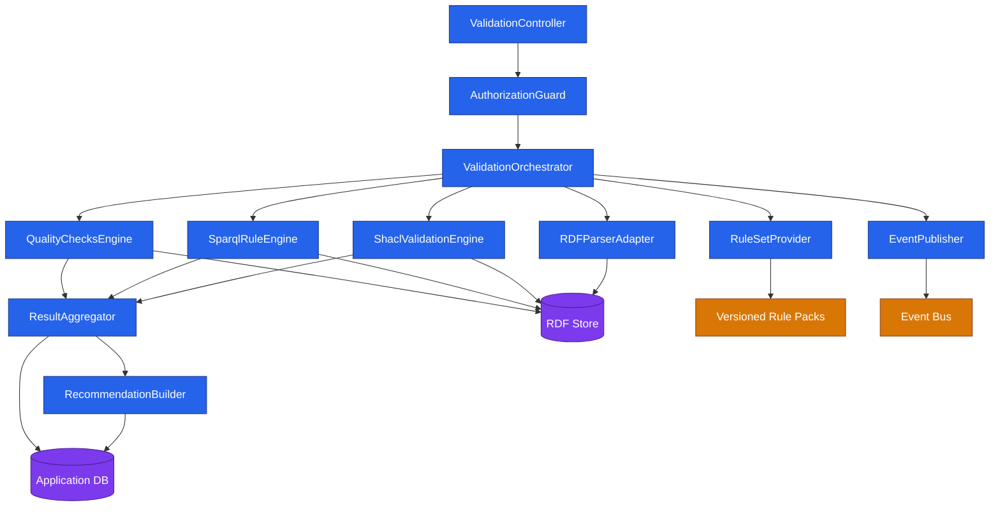
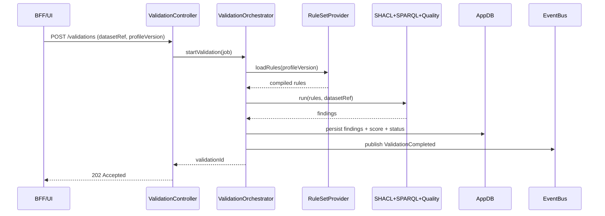

# C4 Level 4 - Compliance Validation Service

Ta dokument opisuje notranjo (code-level) zasnovo mikroservisa za avtomatsko preverjanje skladnosti mobilityDCAT-AP metapodatkov.

## Namen

- Sprejme validacijsko opravilo za en ali vec metapodatkovnih zapisov.
- Izvede sintakticne, semanticne in poslovne kontrole.
- Shrani rezultat validacije in izpostavi porocilo za UI ter porocevalski tok.

## Modulni pogled

## Primarni runtime tok (sekvenca)

## Kljuicne notranje komponente

- ValidationController: REST vhod, validacija payload in idempotency key.
- ValidationOrchestrator: orkestracija vseh korakov validacije.
- RuleSetProvider: nalaganje verzioniranih pravil mobilityDCAT-AP in DG MOVE.
- ShaclValidationEngine: SHACL shape kontrole.
- SparqlRuleEngine: semanticna pravila in cross-record kontrole.
- QualityChecksEngine: popolnost, konsistentnost, formatna pravilnost, unikatnost.
- ResultAggregator: normalizacija findings in izracun skupnega compliance score.
- RecommendationBuilder: predlogi izboljsav po tipu napake.

## Predlagane kode pogodbe (notranje)

- Command: StartValidationCommand
- Query: GetValidationStatusQuery
- Event: ValidationCompleted, ValidationFailed
- DTO: ValidationFindingDto, ValidationSummaryDto

## Nefunkcionalne zahteve

- Asinhrono izvajanje (queue-based) za vecje pakete metapodatkov.
- Deterministicni rezultati za isti vhod + isti profil pravil.
- Popolna sledljivost (audit trail) in verzioniranje pravil.
- Cilj odziva API za oddajo opravila: < 300 ms (p95).
