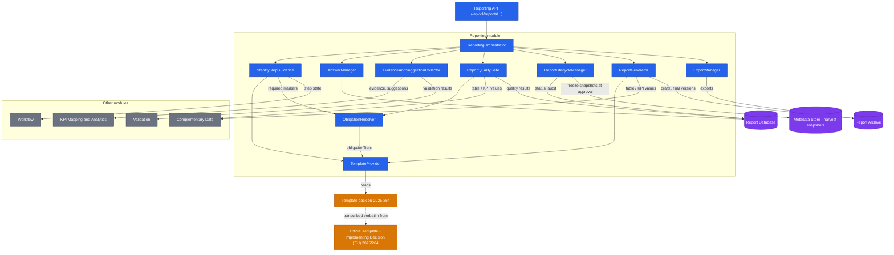
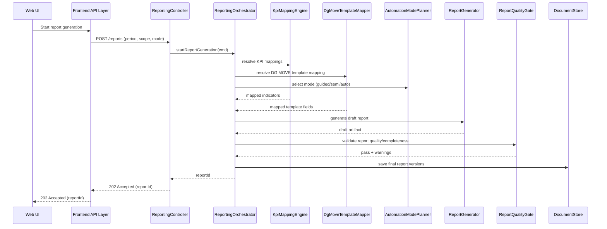

# C4 Level 4 - Reporting Service

This document describes the internal (code-level) design of the microservice for DG MOVE report preparation based on collected and validated metadata.

## Purpose

- Guides the Member State through the Annex I template of Implementing Decision (EU) 2025/264, section by section.
- Collects narrative answers, and shows metadata-derived evidence and suggested values next to them. A person confirms every reported value; full-auto generation is not a goal (ADR-0001).
- Checks completeness against the Annex II obligations and manages the report lifecycle: draft, in-review, approved, exported.
- Renders the report in the Annex I structure and exports it as DOCX, PDF and JSON.

## Module View

Components of the Reporting module, and the other modules and stores it uses. Aligned with ADR-0001, ADR-0002 and ADR-0003; ownership follows [report-data-model.md, section 6](../domain/report-data-model.md#6-ownership-by-c4-container).

- PlantUML source: `docs/architecture/puml/reporting-components.puml`
- SVG export: `docs/architecture/svg/reporting-components.svg`

Removed from the earlier design:

- **Automation Mode Planner**: full-auto generation is dropped (ADR-0001). Automation is recorded per value as provenance (`metadata-suggested`, `computed`, ...), not as a report-wide mode.
- **KPI Mapping Engine**: KPI computation and the metadata mapping are owned by the KPI Mapping and Analytics module.
- **DG MOVE Template Mapper**: report resources use the template pack's stable section, row and KPI IDs directly, so no separate mapping step is needed.
- **Event Publisher**: there is no event bus (ADR-0002).

## Primary Runtime Flow (Sequence)

- Mermaid source: `docs/architecture/mermaid/reporting-primary-runtime-flow.mmd`
- SVG export: `docs/architecture/svg/reporting-primary-runtime-flow-mermaid.svg`

## Key Internal Components

- ReportingController (Reporting API): report resources under `/api/v1/reports`, using the template pack IDs (ADR-0003).
- ReportingOrchestrator: coordinates the components for one report.
- TemplateProvider: loads the versioned template pack; a report keeps the pack version it was created with.
- ObligationResolver: evaluates `obligation(kpi, scope, cycleYear)` from the pack's Annex II data.
- StepByStepGuidance: section and prompt sequence, guidance text and required-field markers; step state is held by the Workflow module.
- AnswerManager: narrative answers with their provenance.
- EvidenceAndSuggestionCollector: metadata facts and suggested values from the KPI Mapping and Analytics module, plus validation results.
- ReportQualityGate: completeness against Annex II obligations, and consistency checks.
- ReportLifecycleManager: draft, in-review, approved, exported; audit trail, revisions, and freezing the harvest snapshots the report cites.
- ReportGenerator: renders the report in the Annex I structure.
- ExportManager: exports DOCX, PDF and JSON to the Report Archive.

## Proposed Internal Code Contracts

- Command: StartReportGenerationCommand
- Query: GetReportStatusQuery
- Event: ReportGenerated, ReportPublished
- DTO: ReportSummaryDto, KpiSnapshotDto

## Non-Functional Requirements

- Support for partial and full automatic modes (manual assist / auto).
- Report versioning and reproducible generation.
- Audit trail of changes per workflow step.
- API response target for report submission: < 300 ms (p95).
