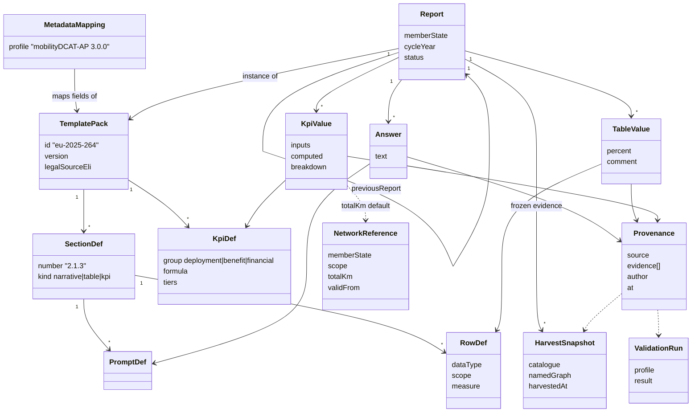

# Report Data Model - ITS Directive Article 17 Implementation Report

This document defines the domain model behind the NAP ITS Reporter: what a report is, where each value comes from, and which parts can be derived from mobilityDCAT-AP metadata. It is the reference for the public API (`/api/v1`) and for the C4 containers that own report data.

Decision record: [ADR-0001](../architecture/adr/0001-report-model-follows-implementing-decision-2025-264.md).

## 1. Legal basis

| Item | Value |
|---|---|
| Template and KPIs | Commission Implementing Decision (EU) 2025/264 of 11 November 2024, [ELI](http://data.europa.eu/eli/dec_impl/2025/264/oj). Annex I: template. Annex II: mandatory or additional KPIs by geographical scope and timeline. |
| Obligation | Article 17 of Directive 2010/40/EU. |
| Cycles | Initial report due 21 March 2025, then a progress report every three years: 2028, 2031, ... |
| Reporting party | One report per Member State and cycle. |
| Format | The Decision fixes the content and structure, not a file format or submission channel. |

The Decision is not a Delegated Regulation. The delegated regulations (2017/1926, 2022/670, 886/2013, 885/2013, 305/2013) are what the report reports *on*.

Machine-readable transcription: [template-packs/eu-2025-264/template.yaml](template-packs/eu-2025-264/template.yaml). Titles, prompts, data types and scopes are verbatim from the Official Journal text and are checked automatically against it.

## 2. What metadata can and cannot provide

| Template part | Content | Primary source |
|---|---|---|
| 1, 2.x.1, 2.x.2, 2.7 | Narrative: activities, progress since the previous report | Member State (manual) |
| 2.1.3, 2.1.4, 2.3.4 | Narrative per delegated regulation: accessibility, quality, compliance assessment, NAP changes, metadata catalogue use | Manual answer, with **metadata-derived facts** alongside |
| 2.3.3 | eCall PSAPs | Manual |
| 2.3.5 | Truck parking counts and shares | Manual; metadata answers "is there dynamic data on the NAP?" |
| 2.5.1-2.5.4 | % of network length, parking places or nodes per data type and scope | Manual figure; metadata gives **evidence**: which datasets exist for that data type and legal act |
| 2.6.1 | SRTI service coverage % | Manual |
| 3.1 | Deployment KPIs (km and node shares) | Manual inputs, computed KPI |
| 3.2 | Benefit KPIs (before/after) | Manual estimates |
| 3.3 | Financial KPIs | Manual |

Metadata never produces a reported percentage. Annex I measures shares of network length or nodes, and mobilityDCAT-AP carries no network lengths. The mapping ([mapping-mobilitydcat-ap-3.0.0.yaml](template-packs/eu-2025-264/mapping-mobilitydcat-ap-3.0.0.yaml)) produces *evidence* and *suggestions*. A person confirms the value.

## 3. Entities

### 3.1 Definitions (template side, read-only at runtime)

- **TemplatePack**: a versioned, immutable transcription of a legal template. If the Decision is amended, a new pack is added; existing reports keep the pack they were created with.
- **SectionDef / PromptDef / RowDef / KpiDef**: the nodes of Annex I. Their IDs (`2.1.3`, `2.1.3/compliance`, `2.5.1/tunnels-core`, `deploy-rtti`) are stable. API paths and exports use them.
- **MetadataMapping**: binds template fields to metadata for one mobilityDCAT-AP profile version. It is separate from the pack because it changes with the specification, not with the law. One pack can have mappings for 1.1.0 and 3.0.0.

### 3.2 Report (instance side)

- **Report**: Member State + cycle year + template pack version. It links to the previous report, which supplies the "progress since [year of previous report]" baseline and pre-fills figures.
- **Answer**: free text for a prompt. Derived facts are shown next to it and can be inserted on purpose, but they are never the answer by default.
- **TableValue**: a percentage for a RowDef. It can use the row's alternative measure where Annex I allows one (e.g. "number and % of tunnels"), plus a comment.
- **KpiValue**: the raw inputs (km, counts, before/after), the computed KPI and the breakdown keys (network type, node type, fixed/mobile equipment, severity). The KPI is always computed from the inputs, never typed in, so the arithmetic can be re-checked.
- **NetworkReference**: national total km per scope (TEN-T core, comprehensive, motorways, primary roads...). It is entered once per Member State and versioned. It supplies the denominators shared across KPIs and the 2.5 tables, so the same network length is not entered differently in different places.

### 3.3 Provenance

Every value carries a Provenance record:

| `source` | Meaning |
|---|---|
| `manual` | Entered by a Member State user |
| `estimate` | Manual, flagged as an informed estimate. Recital: reports "should be based on informed estimates in round figures". |
| `metadata-suggested` | Proposed from harvested metadata and accepted unchanged by a user |
| `previous-report` | Carried over from the previous cycle and confirmed |
| `computed` | KPI computed from inputs |

`evidence[]` references harvest snapshots (dataset IRIs within a named graph) and validation runs. At sign-off the report freezes the snapshots it cites, so the evidence behind a submitted report can be reproduced later.

### 3.4 Lifecycle

`draft → in-review → approved → exported`. Edits are allowed only in `draft`. Each transition is audited (user, time, comment). An `approved` report is immutable; corrections create a new revision.

## 4. Annex II obligation rule

`obligation(kpi, scope, cycleYear) → mandatory | voluntary | additional`

| KPI group | Scope | 2025 | 2028 onwards |
|---|---|---|---|
| Deployment (road), Financial | Core, extended and comprehensive TEN-T (without urban nodes) + motorways | mandatory | mandatory |
| | Urban nodes from TEN-T + primary roads | voluntary | mandatory |
| | Entire road network | additional | additional |
| Deployment (multimodal: 3.1.6, 3.1.7) | Core, extended and comprehensive TEN-T (without urban nodes) + motorways | mandatory | mandatory |
| | Urban nodes from TEN-T + transport nodes + primary roads | voluntary | mandatory |
| | Entire transport network | additional | additional |
| Benefit | Core, extended and comprehensive TEN-T + motorways | voluntary | mandatory |

The rule drives completeness checks (the Reporting Service quality gate) and the UI's required-field markers. It is data in `template.yaml` (`obligationTiers`), not code.

## 5. Metadata evidence derivation

For each table row, the mapping file selects datasets from the harvest snapshot where:

1. `mobilitydcatap:mobilityTheme` contains one of the row's concepts (current or deprecated), **and**
2. `dcatap:applicableLegislation` contains one of the row's legal-act ELIs, **or** none is stated. Rows marked `legislationRequired` need the match, e.g. truck parking, where the parking concepts also cover car parking.
3. `mobilitydcatap:networkCoverage` matches the row's scope hint, **or** is absent, in which case the dataset is flagged "scope unknown".

The result is a suggestion with a fidelity level (`exact`, `partial`, `none`) and the dataset list. Prompt derivations (`catalogue-profile`, `assessments`, `quality-annotations`, `dataset-inventory`, `catalogue-diff`) produce fact blocks for the narrative sections. The properties are taken from the mobilityDCAT-AP 3.0.0 ontology: `assessmentResult` and `dqv:hasQualityAnnotation` on Dataset, `mobilityDataStandard` on Distribution.

## 6. Ownership by C4 container

| Container | Owns |
|---|---|
| Reporting Service | TemplatePack (loading), Report, Answer, lifecycle, export, quality gate |
| Complementary Data Service | Manual TableValue / KpiValue inputs, NetworkReference, import of the previous report |
| KPI Mapping and Analytics Service | MetadataMapping, evidence derivation, KPI computation |
| Compliance Validation Service | ValidationRun |
| Metadata Ingestion / Registry | HarvestSnapshot (named graphs in the RDF store) |

## 7. Findings, assumptions and open questions

Findings from the legal text and the vocabularies (checked 2026-10-23):

- **F1 - TEN-T terminology differs between annexes.** Annex II uses "Core, extended and comprehensive TEN-T", while Annex I tables use only core and comprehensive. Both are kept verbatim as separate scope sets (`scopes`, `kpiScopes`).
- **F2 - Network coverage is too coarse.** The `network-coverage` vocabulary has a single `ten-network` concept: no core/comprehensive split and no "primary roads". Metadata cannot place a dataset in an Annex I scope. Scope hints are `coarse` at best.
- **F3 - MMTIS legislation IRIs differ.** Annex I cites 2017/1926, but the mobility-theme vocabulary tags MMTIS themes with the amending act 2024/490. The mapping accepts both.
- **F4 - Truck parking themes are deprecated.** In v3 the truck-parking themes are deprecated in favour of generic parking concepts that are not tagged with 885/2013. Identifying truck parking therefore depends on dataset-level `applicableLegislation`.
- **F5 - Some SRTI events have no concept.** Wrong-way driver, unmanaged blockage and some others have no specific mobility-theme concept. Only "SRTI datasets exist" can be shown for them.

Assumptions (to confirm):

- **A1** - The report is exported as a document following Annex I numbering (DOCX/PDF), plus JSON for machine exchange. No Commission submission API is assumed.
- **A2** - Obligations marked "Mandatory in 2028" remain mandatory for 2031 and later.
- **A3** - Member States report the national total network lengths themselves. No EU reference network dataset is integrated.

Open questions:

- **Q1** - Should finer network-coverage concepts (core/comprehensive TEN-T, primary roads) be proposed to mobilityDCAT-AP, or provided as an adopter extension vocabulary?
- **Q2** - Which mobilityDCAT-AP versions need mappings besides 3.0.0? Candidates are 1.0.1 and 1.1.0, which most NAPs are expected to use.
- **Q3** - Should approved reports be published back as RDF (e.g. DCAT records for the report)?
